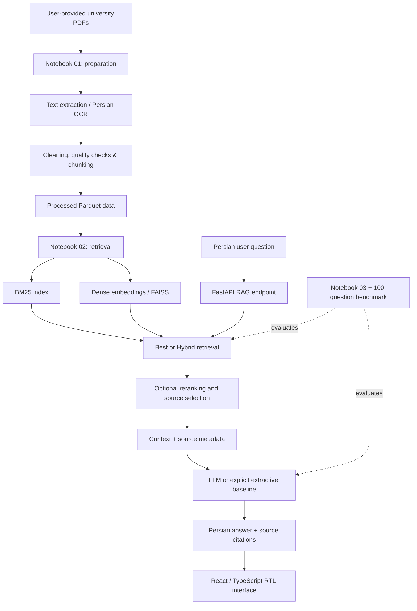
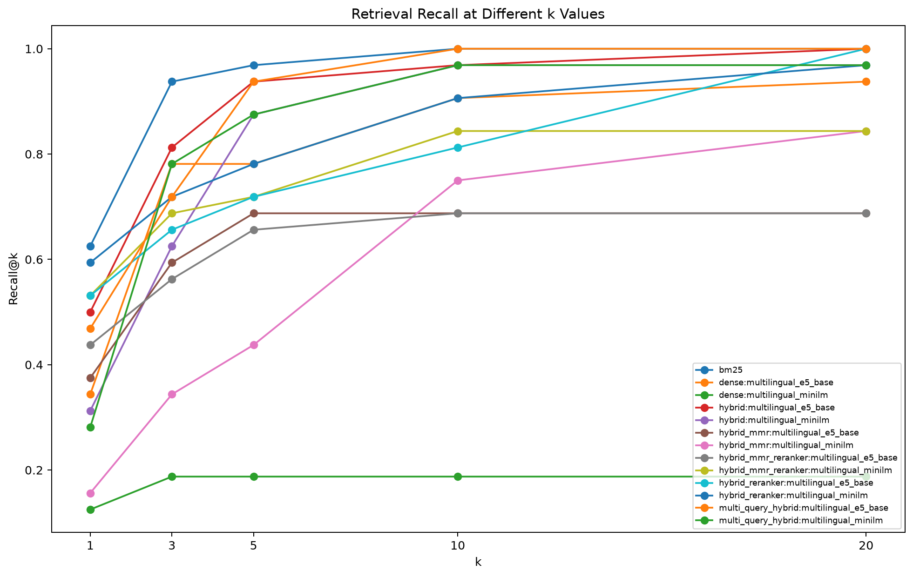
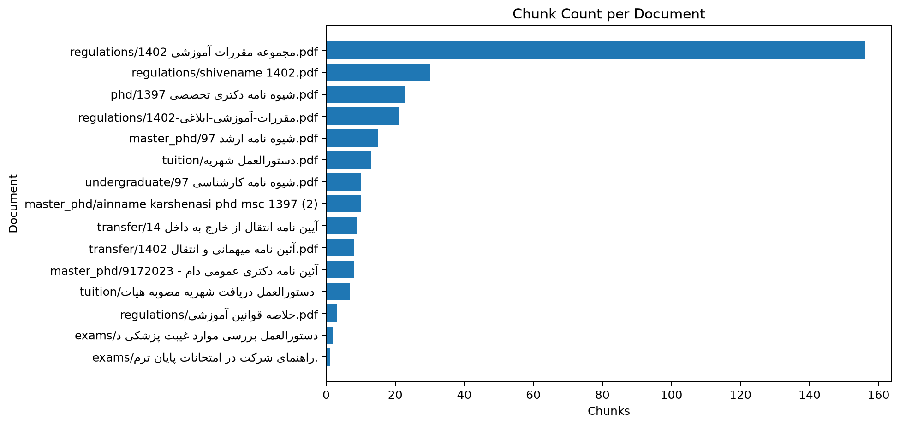

# University RAG: Persian Academic Regulations Question Answering

**An end-to-end, citation-aware Retrieval-Augmented Generation (RAG) system for Persian university regulations.**

**Academic context:** Final project for the **Natural Language Processing (NLP)** course, **Spring 2026**, **Shahid Bahonar University of Kerman (UoK), Iran**.  
**Project author:** **Hiva Abolhadizadeh**  
**Project type:** Academic NLP / information retrieval / LLM application and evaluation  
**Interface language:** Persian (right-to-left); documentation: English

> **Portfolio / research prototype — not an official university service.** The application is intended to answer questions *from a user-provided collection of regulations* and surface the retrieved source passages. It should not be used as an authoritative source for current academic policies. Always check the original, up-to-date documents.

## Contents

1. [Overview](#overview)
2. [What the system does](#what-the-system-does)
3. [System architecture](#system-architecture)
4. [Methods and implementation](#methods-and-implementation)
5. [Technology stack](#technology-stack)
6. [Project layout](#project-layout)
7. [What is and is not included in this repository](#what-is-and-is-not-included-in-this-repository)
8. [Prerequisites](#prerequisites)
9. [Quick start (Windows / PowerShell)](#quick-start-windows--powershell)
10. [Manual setup (Windows, Linux, macOS)](#manual-setup-windows-linux-macos)
11. [Adding documents and building the retrieval index](#adding-documents-and-building-the-retrieval-index)
12. [LLM configuration](#llm-configuration)
13. [API endpoints](#api-endpoints)
14. [Evaluation setup](#evaluation-setup)
15. [Recorded experimental results](#recorded-experimental-results)
16. [Running evaluations](#running-evaluations)
17. [Tests and quality checks](#tests-and-quality-checks)
18. [Publishing this complete-results release to GitHub](#publishing-this-complete-results-release-to-github)
19. [Troubleshooting](#troubleshooting)
20. [Limitations, ethics, and security](#limitations-ethics-and-security)
21. [Future improvements](#future-improvements)
22. [Author and project status](#author-and-project-status)

## Overview

Academic regulations are often stored in long PDFs, scanned documents, and files that use inconsistent formatting. Finding an exact policy, exception, or relevant article can be difficult, particularly when a question is phrased differently from the source. **University RAG** explores a pipeline for retrieving relevant Persian regulatory text, composing a grounded response, and showing its supporting evidence.

The repository includes **three executed research notebooks with their original cell outputs**, archived **extracted and processed datasets**, **retrieval indexes and experiment artifacts**, a **FastAPI** backend, a **React/TypeScript** frontend, tests, and a **100-question evaluation benchmark**. The application exposes two retrieval choices: the selected **Best** path, based on the retrieval experiments, and a configurable **Hybrid** path that combines lexical and semantic retrieval.

The course project investigated both **retrieval quality** (e.g., Recall@K, MRR) and **answer quality** (automated answer-key matching and citations). It is an engineering and evaluation project; it does **not** claim to introduce a novel RAG algorithm.

## What the system does

- **Persian document preparation:** read PDFs, detect document/page quality, select text extraction or OCR for scanned pages, normalize Persian text, and generate overlapping chunks with source metadata.
- **Multiple retrieval strategies:** sparse **BM25**, multilingual dense embeddings, **hybrid** rank fusion, optional diversity selection (**MMR**), and cross-encoder reranking.
- **Document-aware behavior:** preserve title, document category, page/article references, and prefer relevant current regulations over superseded sources when the metadata allows.
- **Grounded answer generation:** build a bounded source context, request a structured Persian answer, return source citations, and support no-answer behavior when evidence is insufficient.
- **Local model/provider settings:** configurable **Gemini**, **OpenAI**, or an explicitly selected **mock/extractive** baseline. Real-provider failures are not intended to silently become mock answers.
- **Web application:** RTL chat, source display, document management, query suggestions, LLM settings, indexing controls and evaluation-related views.
- **Experiment tracking:** notebooks, recorded evaluation summaries, plots, and an independently runnable evaluation script.

## System architecture



**Research workflow:** run Notebook 01 (documents → chunks), Notebook 02 (chunks → retrieval artifacts), then Notebook 03 (generation/evaluation experiments). **Application workflow:** start the backend/frontend once the Notebook 02 artifacts exist, then select a provider and ask questions.

### A sample request lifecycle

1. The user submits a Persian question in the browser.
2. FastAPI validates the request and selects the chosen retrieval mode.
3. The retriever searches the local indexes; Hybrid may combine BM25 and dense rankings.
4. The retriever filters, deduplicates, and optionally reranks candidate passages.
5. The generator receives the question plus selected source passages and provenance fields.
6. The application returns an answer and a list of cited sources; the UI displays both.

## Methods and implementation

### 1. Document preparation — `notebooks/01_Data_Preparation.ipynb`

- Inspect PDF metadata and page quality.
- Use **PyMuPDF** when direct text extraction is usable, or **Tesseract OCR** with Persian (`fas`) and English (`eng`) language data where needed.
- Normalize characters, numerals, whitespace and common extraction artifacts.
- Track quality/status and organize input documents into topic categories.
- Segment the text into article-aware / overlapping chunks. The default configuration targets **400 tokens**, with **300–500** tokens as the nominal range and **80** tokens of overlap, subject to document structure.
- Write local Parquet datasets, quality summaries, and figures.

### 2. Retrieval — `notebooks/02_Retrieval_Pipeline.ipynb`

- **Sparse:** `rank-bm25` with Persian-normalized tokens.
- **Dense:** multilingual sentence embeddings; configured model candidates include `intfloat/multilingual-e5-base` and `sentence-transformers/paraphrase-multilingual-MiniLM-L12-v2`.
- **Hybrid:** combine sparse/dense rankings with reciprocal-rank fusion (RRF).
- **Optional:** MMR, cross-encoder reranking, source deduplication, document-aware filtering, score threshold calibration and retrieval diagnostics.
- Generate index files and a manifest for the backend, including the selected retriever configuration.

The configured **Best** method refers to the method selected from Notebook 02's evaluation process; it does *not* imply that Best always outperforms Hybrid on subsequent question sets.

### 3. Grounded generation — `notebooks/03_Generation_and_Evaluation.ipynb`

- Select relevant contexts and preserve document/page/article metadata.
- Experiment with citation-aware prompts and answer-generation configurations.
- Compare explicitly configured generation providers and an extractive mock baseline.
- Evaluate answerability, citation grounding, robustness, latency and automatically scored answer quality.

### 4. Web application — `backend/` and `frontend/`

- FastAPI exposes health, query, documents, upload, settings, index and evaluation routes.
- A React / TypeScript / Vite frontend provides a Persian right-to-left experience.
- The local LLM settings manager avoids returning full API keys to the browser, and supports OS-keyring persistence where available.
- **Security scope:** this is a **local prototype**, not a hardened, multi-tenant public deployment. Do not put it on the open Internet without additional authentication, authorization, rate limits and deployment safeguards.

## Technology stack

| Layer | Main tools |
|---|---|
| Data preparation | Python, Pandas, NumPy, PyMuPDF, Tesseract, Hazm, OpenCV, PyArrow |
| Retrieval | `rank-bm25`, Sentence Transformers, Hugging Face Transformers, FAISS, ChromaDB |
| Generation | Gemini / OpenAI integrations, optional extractive mock, structured prompting |
| Service | FastAPI, Uvicorn, Pydantic, HTTPX |
| Frontend | React, TypeScript, Vite, React Router, Lucide icons |
| Experimentation | Jupyter, Matplotlib, scikit-learn, CSV / JSON reports |
| Testing | Pytest; TypeScript checks |

The complete Python environment is specified in `requirements.txt`; the frontend dependencies are in `frontend/package.json` and its lockfile. Some ML libraries and model downloads are **large**.

## Project layout

```text
University_RAG/
├── README.md                       # You are here
├── .env.example                    # Safe template; no real credentials
├── .gitignore
├── requirements.txt
├── config.yaml                     # PDF/OCR/chunking settings
├── retrieval_config.yaml           # BM25, dense, hybrid, reranking settings
├── generation_config.yaml          # Generation prompts/providers/evaluation
├── notebooks/
│   ├── 01_Data_Preparation.ipynb
│   ├── 02_Retrieval_Pipeline.ipynb
│   └── 03_Generation_and_Evaluation.ipynb
├── backend/
│   ├── app/
│   │   ├── main.py                 # FastAPI entry point
│   │   ├── api/routes.py           # API endpoints
│   │   ├── config.py               # Runtime settings
│   │   └── services/               # RAG, retrieval, generation, documents, indexing
│   └── tests/                      # Backend tests
├── frontend/
│   ├── package.json
│   ├── package-lock.json
│   ├── public/                      # Neutral project mark
│   └── src/                         # RTL React application
├── evaluation/
│   ├── evaluate_rag.py             # API-based evaluator
│   └── rag_eval_100.json           # Course benchmark (100 questions)
├── results/                         # Selected recorded evaluation summaries
├── docs/
│   ├── EVALUATION.md               # Experimental results and caveats
│   ├── SECURITY_AND_DATA.md        # Data, privacy and key-handling guidance
│   └── figures/                    # Selected experiment visualizations
├── scripts/
│   ├── start_project.ps1           # Windows local launcher
│   └── stop_project.ps1
├── data/
│   ├── raw/                         # Original PDF sources excluded; add locally if rebuilding
│   ├── processed/                   # Committed: extracted text, metadata and Parquet tables (Notebook 01)
│   ├── retrieval/                   # Committed: embeddings, indices, metrics and plots (Notebook 02)
│   └── generation/                  # Committed: selected experiments and metrics (Notebook 03)
├── reports/
│   ├── data_preparation/            # Recorded Notebook 01 figures
│   ├── rag_evaluation/              # Curated prior report
│   └── rag_evaluation_gemini_final/ # Curated final run report
└── logs/                            # Local runtime logs (ignored)
```

**Important entry points:**

- Backend: `backend/app/main.py` (`uvicorn backend.app.main:app`)
- Frontend: `frontend/src/main.tsx` (`npm run dev` inside `frontend/`)
- RAG orchestration: `backend/app/services/rag.py`
- Retrieval implementation: `backend/app/services/retriever.py`
- Evaluator: `evaluation/evaluate_rag.py`

## Prerequisites

- **Python:** preferably 3.11 or 3.12 (recommended, not a cross-platform compatibility guarantee).
- **Node.js + npm:** a version satisfying `frontend/package.json` (currently Node `>=20.19.0`; recent Node 22 also suitable).
- **Git:** recommended for version control.
- **Tesseract OCR:** optional for entirely text-based PDFs; for scanned Persian documents, install the Tesseract executable **and** its `fas` language data (and `eng` where used).
- **Internet:** required for installing packages, downloading embedding/reranker models, and calling cloud LLM providers.
- **Hardware/storage:** model installation and indexing can require substantial disk space, RAM and processing time.

See `config.yaml` to change OCR language, chunk sizes and data directories. Leave `ocr.tesseract_cmd` blank when the executable is available on `PATH`; otherwise configure its local full path.

## Quick start (Windows / PowerShell)

Open **PowerShell** in the project root (the folder containing this README).

### 1. Create the environment

```powershell
py -m venv .venv
Set-ExecutionPolicy -Scope Process Bypass
.\scripts\start_project.ps1 -SetupOnly
```

The setup launcher checks for `.venv`, installs Python dependencies, and copies `.env.example` to `.env` if needed. Because `requirements.txt` contains large ML dependencies, first-time installation may take a while.

### 2. Choose archived indexes or rebuild

This edition **already includes the archived processed data and retrieval indexes**. If those assets load successfully with your local library versions, you can start the application without reprocessing the original PDFs. The original PDFs are **not** bundled. To rebuild or replace the corpus, follow [Adding documents and building the retrieval index](#adding-documents-and-building-the-retrieval-index) below. Do not mix indexes and chunks from different runs.

### 3. Start the backend and frontend

```powershell
.\scripts\start_project.ps1
```

If your dependencies are already installed, skip the installation check:

```powershell
.\scripts\start_project.ps1 -SkipInstall
```

The launcher starts the backend and frontend in separate Windows PowerShell processes. It also creates an ignored `frontend/.env.local` file if needed.

| Service | Local URL |
|---|---|
| Web interface | http://127.0.0.1:5173 |
| API | http://127.0.0.1:8000 |
| Interactive API docs | http://127.0.0.1:8000/docs |
| API health | http://127.0.0.1:8000/api/health |

To stop locally launched processes:

```powershell
.\scripts\stop_project.ps1
```

Other launcher flags: `-BackendOnly`, `-SetupOnly`, `-RunTests`, `-BackendPort` and `-FrontendPort`. For example:

```powershell
.\scripts\start_project.ps1 -SetupOnly -RunTests
.\scripts\start_project.ps1 -BackendOnly -SkipInstall
```

## Manual setup (Windows, Linux, macOS)

The `.ps1` launcher targets **Windows**. The application can also be launched manually on other systems, subject to compatible native dependencies.

```bash
# From the project root
python -m venv .venv
source .venv/bin/activate             # Linux/macOS
# Windows PowerShell equivalent: .\.venv\Scripts\Activate.ps1
python -m pip install -r requirements.txt
cp .env.example .env                  # PowerShell: Copy-Item .env.example .env
```

Once dependencies are installed, use the included archived retrieval assets or rebuild them as described below, then start the API:

```bash
python -m uvicorn backend.app.main:app --reload --host 127.0.0.1 --port 8000
```

In another terminal:

```bash
cd frontend
npm ci
# Copy .env.example to .env.local if you need to change API settings.
npm run dev
```

**Note:** `npm ci` expects the committed package lock to match `package.json`. The frontend is configured to bind to `127.0.0.1` by default. For a different backend URL, set `VITE_API_BASE_URL` in `frontend/.env.local`.

## Adding documents and building the retrieval index

### Stage 0 — input PDFs (needed only to rerun Notebook 01)

The repository already contains the original experiment's processed artifacts. You **do not need the raw PDFs to inspect data, view results or attempt to use the shipped indexes**. The PDFs are necessary to rerun *document extraction from scratch* or to add new policies.

Place **PDFs you are authorized to process** under one or more category folders in `data/raw/`:

```text
data/raw/
├── exams/
├── master_phd/
├── phd/
├── regulations/
├── transfer/
├── tuition/
└── undergraduate/
```

Create the folders as needed; filenames may be Persian. These directories are ignored by Git. For example:

```powershell
New-Item -ItemType Directory -Force data\raw\regulations
Copy-Item "C:\path\to\your\permitted-regulation.pdf" data\raw\regulations\
```

### Stage 1 — data preparation (Notebook 01)

If you need to reproduce data preparation from original inputs (which are not redistributed), start Jupyter in the **project root**:

```bash
python -m jupyter notebook
```

Open `notebooks/01_Data_Preparation.ipynb` and **Run All**. Review the preflight results, especially OCR availability. Expected local outputs include:

- `data/processed/chunks.parquet`
- `data/processed/documents.parquet`
- `data/processed/metadata.json`
- `data/processed/quality_report.json` and related summaries/plots

The notebook **already includes archived displayed outputs**; those should not be mistaken for new computations. If a PDF consists of scanned images and Tesseract/Persian language data are unavailable, the extracted text may be incomplete. Fix OCR before proceeding rather than assuming the retrieval index is correct.

### Stage 2 — retrieval experiments and index construction (Notebook 02)

Notebook 02's executed outputs, report charts and index artifacts are **included**. To regenerate them after an environment change, open `notebooks/02_Retrieval_Pipeline.ipynb` and **Run All**. This notebook consumes the Stage 1 chunks, evaluates configured retrievers, and writes local retrieval artifacts. The backend requires at least:

- `data/retrieval/indexes/index_manifest.json`
- `data/retrieval/reports/best_retriever_config.yaml`
- `data/processed/chunks.parquet` (from Stage 1)
- Any index/embedding assets referenced by that manifest.

These generated files must correspond to **the same chunk ordering and corpus**. Do not combine a new `chunks.parquet` with an old manifest or serialized index.

The sentence-embedding models may be downloaded on the first run. A network connection is usually required unless the models are cached locally.

### Stage 3 — generation experiments (Notebook 03, optional for serving)

Notebook 03 includes its archived output cells. Open `notebooks/03_Generation_and_Evaluation.ipynb` and **Run All** to repeat generation experiments against the indexes produced in Stage 2. Configure only the providers you are authorized to use. Notebook 03 is **for experiments** and does not need to run before every API start.

### Optional — UI-triggered rebuilds

The API exposes document upload and index rebuild operations. **Automatic rebuild is disabled by default** (`ENABLE_INDEX_REBUILD=false`). To enable it locally, set this to `true` in `.env` after verifying the notebook dependencies. The corrected rebuild paths in `.env.example` point to Notebook 01 and Notebook 02 shipped in this repo. Rebuilds can be long-running and must **not** be exposed to untrusted users.

After creating/recreating the index, **restart the backend** (or use the configured rebuild flow) to load new assets.

## LLM configuration

The application supports **mock**, **Gemini**, and **OpenAI** runtime options. In this release, `.env.example` starts with:

```dotenv
LLM_PROVIDER=mock
ALLOW_MOCK_FALLBACK=false
OPENAI_API_KEY=
OPENAI_MODEL=
GEMINI_API_KEY=
GEMINI_MODEL=
```

The default **mock** is an explicitly selectable extractive baseline, not evidence of cloud-LLM performance. With `ALLOW_MOCK_FALLBACK=false`, a failed real provider should not be silently replaced by mock output.

For a real provider, set the credentials **locally**, preferably through the web interface's **Settings** page (where supported) or in your uncommitted `.env` file, and select a supported model. The app's local settings manager does not send full saved keys back to the frontend. Keyring persistence depends on your operating system.

**Never commit `.env`, API keys, generated logs or copied requests containing credentials.** API billing and rate limits are the responsibility of the user configuring the provider. No online service or key is bundled.

## API endpoints

The application provides interactive request and response schemas at [`/docs`](http://127.0.0.1:8000/docs) once locally running.

| Method | Endpoint | Purpose |
|---|---|---|
| GET | `/api/health` | Service and retriever/model readiness |
| POST | `/api/query` | Ask a question with a selected retrieval mode |
| GET | `/api/questions/suggest` | Query autocomplete |
| GET | `/api/documents` | List indexed documents |
| GET | `/api/categories` | Available document categories |
| POST | `/api/documents/upload` | Upload a local PDF for later reindexing |
| POST | `/api/index/rebuild` | Trigger disabled-by-default notebook rebuild |
| GET | `/api/index/status` | Read index rebuild status |
| GET | `/api/settings/llm` | Inspect configured LLM settings (without revealing full keys) |
| PUT | `/api/settings/llm` | Update LLM settings |
| DELETE | `/api/settings/llm` | Clear LLM settings |
| POST | `/api/settings/llm/models` | Get provider/model options |
| POST | `/api/settings/llm/test` | Test provider configuration |
| GET | `/api/evaluation/summary` | Inspect locally available evaluation data |

The exact input schema is defined in `backend/app/schemas.py`. Use `/docs` rather than constructing unverified request bodies from examples.

## Evaluation setup

The project includes [`evaluation/rag_eval_100.json`](evaluation/rag_eval_100.json), a **100-question Persian evaluation set** with fields including `question`, reference `ground_truth`, expected `source`, `difficulty`, and `question_type`. The original experiments also used **automatically generated silver retrieval queries**, which should not be mistaken for expert-created gold labels.

Metrics used across the pipeline:

| Metric | Interpretation / caveat |
|---|---|
| Source Recall@K | Whether the expected source was found among top-K results |
| MRR | Reciprocal rank of the first matching expected source |
| `heuristic_accuracy` | Automatic Persian answer-key scoring, **not** independently human-verified factual accuracy |
| Valid citation rate | Whether output citations were valid under the evaluator's citation-checking rules, **not** a guarantee that the answer was entailed by the cited text |
| Token F1 | Token-level answer overlap; sensitive to long paraphrases and OCR errors |
| Provider success rate | Fraction of calls recorded as successful; important for interpreting comparisons |
| Latency | Time measured in the original run and environment; may vary elsewhere |

Evaluation is sensitive to source-document version, OCR quality, retrieval configuration, model version, API availability, prompt and scoring implementation. See [docs/EVALUATION.md](docs/EVALUATION.md) for interpretation and limitations.

## Recorded experimental results

**Historical snapshot — 100 questions; Gemini-backed evaluation run dated July 18, 2026.** The repository includes saved extracted data, retrieval assets, aggregate summaries, selected per-question evaluation files, and executed notebooks, but not original PDF scans or full raw provider-response logs.

| Retrieval mode | Questions | Heuristic answer accuracy | Source Recall@5 | MRR | Valid citations | Provider success |
|---|---:|---:|---:|---:|---:|---:|
| Best (earlier selected configuration) | 100 | 64% | 93% | 0.707 | 97% | **65%** |
| Hybrid | 100 | **81%** | **95%** | **0.763** | 96% | **100%** |

**Interpretation is essential:** the Best run had **only 65% provider success** (i.e., significant fallback/failure behavior), whereas the Hybrid run achieved 100% provider success. Therefore, **81% vs. 64% is not a controlled, like-for-like scientific demonstration of Hybrid's superiority**. The 81% value is heuristic automatic accuracy rather than an expert adjudication. On the small *reasoning* subset (9 questions), Hybrid also did not lead on heuristic accuracy. Both retrieval modes should be re-evaluated with identical model/provider settings, no silent fallback, fixed documents and independent manual review.

**Corpus statistics from the archived preprocessing run:** 15 distinct documents, 277 pages, 316 chunks (14 documents judged retrieval-ready; 1 flagged for review). The pipeline reported 146 pages processed via OCR. The corresponding **extracted files are now bundled in `data/processed/`**; original source PDFs remain omitted.





Additional evaluation figures and machine-readable snapshots are provided under `docs/figures/` and `results/`.

## Running evaluations

Start the backend after building the index; configure a working LLM provider if you want cloud-LLM measurements. The evaluation script calls the local API. For a **3-question smoke evaluation** on Hybrid:

**Windows / PowerShell**:

```powershell
.\.venv\Scripts\python.exe .\evaluation\evaluate_rag.py --modes hybrid --limit 3 --delay 10 --output-dir reports\evaluation_smoke --reset
```

**Linux / macOS**:

```bash
python evaluation/evaluate_rag.py --modes hybrid --limit 3 --delay 10 --output-dir reports/evaluation_smoke --reset
```

For a longer original-style comparison:

```powershell
.\.venv\Scripts\python.exe .\evaluation\evaluate_rag.py --modes best hybrid --delay 10 --output-dir reports\rag_evaluation_local --reset
```

For an interrupted run, use `--resume` instead of `--reset`. To recompute scores from an existing local run without re-querying the provider:

```powershell
.\.venv\Scripts\python.exe .\evaluation\evaluate_rag.py --recalculate-only --output-dir reports\rag_evaluation_local
```

New locally generated evaluation outputs normally include `summary.json`, `evaluation_report.md`, `raw_results.jsonl`, and `per_question_results.csv`. The repository includes a **curated selection** of past evaluation reports, but intentionally omits full raw model-response dumps. New evaluation output directories should be reviewed for privacy, licensing, and API data before committing.

## Tests and quality checks

Backend tests are in `backend/tests/`. Run from the project root after installing dependencies:

```bash
python -m pytest backend/tests -q
```

The Windows helper also supports:

```powershell
.\scripts\start_project.ps1 -SetupOnly -RunTests
```

Frontend checks:

```bash
cd frontend
npm ci
npm run typecheck
npm run build
```

**Validation note:** this edition preserves archived notebook output and stage artifacts but was not independently re-executed end to end. Check dependency compatibility before relying on bundled binary indexes; for a fresh raw-document run, obtain the source documents lawfully.

## Publishing this complete-results release to GitHub

You can commit the **contents of this directory directly** after verifying redistribution rights for the extracted regulatory text: the `.gitignore` excludes local PDF sources, `.env` files, runtime caches, and unreviewed logs; **the processed datasets, saved indexes, and research outputs are intentionally tracked**. Recommended repository name: `persian-university-rag`.

**Suggested GitHub description:** "Persian university-regulations RAG system: BM25 + dense/hybrid retrieval, cited LLM answers, FastAPI/React UI, and NLP course evaluation (Spring 2026)."

**Suggested topics:** `rag`, `nlp`, `persian-nlp`, `information-retrieval`, `bm25`, `hybrid-search`, `llm`, `fastapi`, `react`, `university-project`.

If you created an **empty repository** on GitHub, run these commands from the root of this extracted project (replace the placeholder with **your own** new repository URL):

```bash
git init
git branch -M main
git add .
git status                            # Review before committing!
git commit -m "Publish Spring 2026 NLP University RAG project"
git remote add origin https://github.com/YOUR_USERNAME/persian-university-rag.git
git push -u origin main
```

You do **not** need to upload the ZIP file itself to GitHub; extract it and commit the project files. For an existing remote repository, review differences before pushing. Do not commit source PDFs or secrets unless you have a clear reason and the necessary rights. You can optionally add an open-source license later if you are the copyright holder and choose to allow reuse.

## Troubleshooting

<details>
<summary><strong>Backend health says unavailable</strong></summary>

Expected before indexing. Run Notebooks 01 and 02, then restart the backend. Also verify `data/processed/chunks.parquet`, `data/retrieval/indexes/index_manifest.json`, the selected retriever configuration, and all referenced asset files. The manifest and chunks must describe the same corpus and ordering.
</details>

<details>
<summary><strong>OCR produces no Persian text</strong></summary>

Install Tesseract, ensure its Persian (`fas`) and English (`eng`) language packages are visible, and adjust `config.yaml` if Tesseract is not on `PATH`. `pytesseract` alone does not install the native executable or language data.
</details>

<details>
<summary><strong>Indexing is slow or models cannot download</strong></summary>

Dense embedding and reranker models may be downloaded on first run. Check network restrictions, free disk space and available memory. You can disable unused embedding models or reranking in the YAML configuration, but changing settings changes your experiment and may affect downstream asset requirements.
</details>

<details>
<summary><strong>Frontend starts but API calls fail</strong></summary>

Start the backend first. Confirm `VITE_API_BASE_URL` points to the local backend and keep the frontend/backend hostnames consistent (recommended `127.0.0.1` for both). Check `/api/health` and `/docs` for diagnostics.
</details>

<details>
<summary><strong>Requests fail after changing API provider</strong></summary>

Check the provider key, model availability, billing quota and local Settings connection test. `ALLOW_MOCK_FALLBACK=false` intentionally avoids silent mock substitution; correct the real-provider failure rather than interpreting fallback as success.
</details>

<details>
<summary><strong>Windows PowerShell blocks the launcher</strong></summary>

For your current PowerShell process only, run `Set-ExecutionPolicy -Scope Process Bypass`, or launch scripts from an appropriately configured terminal. Never run unreviewed downloaded scripts with elevated privileges.
</details>

## Limitations, ethics, and security

1. **No bundled corpus**: raw regulation PDFs and derived text are deliberately excluded, so the service requires local setup to answer content questions.
2. **Regulations change**: answers may become outdated; the system does not continuously synchronize with an official source. Date/authority handling is heuristic.
3. **OCR is imperfect**: Persian ligatures, scans, tables and article boundaries can generate errors, which can propagate into retrieval and answers.
4. **Limited experimental evidence**: the 100-question set is domain-specific, partly automatic scoring was used, and original provider success differed across compared runs.
5. **Citations are not proof of correctness**: syntactically valid citations do not guarantee the supporting evidence entails every claim in the answer.
6. **Privacy/security**: file uploads, index builds and provider settings are intended for a trusted local environment. API endpoints should not be treated as production-grade, externally authenticated workflows.
7. **Permissions**: users must ensure they are allowed to process and share their uploaded PDFs, and verify licenses for external dependencies, embedding models and graphical assets.
8. **Cost/reproducibility**: external inference can incur fees or rate limits; software versions and pretrained models may change results over time.

See [SECURITY_AND_DATA.md](docs/SECURITY_AND_DATA.md) for details of the public-source cleanup and safe publication workflow.

## Future improvements

- Human-annotated evaluation of correctness, completeness, and citation support.
- Controlled comparisons with identical provider settings and retry/failure handling.
- Stronger temporal/versioned policy retrieval and conflict resolution.
- Robust PDF table extraction and additional Persian OCR quality checks.
- Automated indexing workflow with better progress reporting and error recovery.
- Docker-based reproducible environments and integration tests.
- A redistributable synthetic example corpus (clearly separate from actual regulations) for zero-setup demonstration.

These are **potential extensions**, not features claimed as already implemented.

## Author and project status

**Hiva Abolhadizadeh**  
**Course:** Natural Language Processing (NLP), **Spring 2026**  
**Institution:** Shahid Bahonar University of Kerman (UoK), Iran  
**Original purpose:** Course final project, now organized for a public academic/engineering portfolio.

The repository documents a course project and its recorded experiments. It is not an official university product or a maintained source of regulations. Any university names used describe the academic context and source domain, not endorsement.

**License:** No open-source license is supplied automatically. Unless the copyright holder adds a license, default copyright rules apply. Please contact the project author before reusing source code beyond what applicable law permits.
