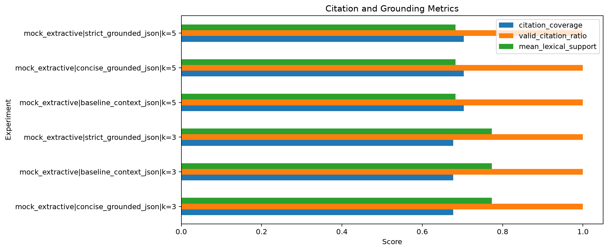

# Evaluation: methodology, archived results and interpretation

This note documents **recorded course-project experiments**, not a freshly reproduced public-source release. The cleaned repository contains the API-based evaluator, its 100-question benchmark, three research notebooks, selected plots, and aggregate results. It omits the archived corpus, derived private text, and raw answer logs.

## Dataset and questions

- Domain: Persian academic/university regulations.
- Archived preprocessing: **15 unique documents, 277 pages, 316 chunks** (14 retrieval-ready, 1 needs review); **146 OCR-used pages**.
- End-to-end benchmark: **100 Persian questions** (`evaluation/rag_eval_100.json`) with reference answers, expected source/article, question difficulty and question type.
- Difficulty composition in the final archived evaluation: **36 easy, 42 medium, 22 hard**.
- Question-type composition: **91 factoid and 9 reasoning**; conclusions about reasoning are especially uncertain due to the small subset.
- Notebook 02's originally selected retrieval configuration was marked `provisional_silver`, using automatically generated *silver* queries. This is not a gold evaluation.

## Final archived end-to-end comparison (July 18, 2026)

The following metrics come from the source archive's `reports/rag_evaluation_gemini_final/summary.json` and report and are recorded here for transparency.

| Metric | Best | Hybrid |
|---|---:|---:|
| Questions | 100 | 100 |
| Heuristic answer accuracy | 64.0% | 81.0% |
| Source Recall@1 | 56.0% | 65.0% |
| Source Recall@3 | 85.0% | 85.0% |
| Source Recall@5 | 93.0% | 95.0% |
| MRR | 0.7073 | 0.763 |
| Valid citation rate | 97.0% | 96.0% |
| No-answer rate | 3.0% | 4.0% |
| Mean token F1 | 0.164 | 0.215 |
| Provider success | **65.0%** | **100.0%** |

**Major confound:** provider success was 65% for Best versus 100% for Hybrid, so this is **not a controlled isolated retrieval comparison**. It would be misleading to claim that the answer-accuracy difference alone establishes Hybrid as intrinsically superior. The original system also included fallback behavior in earlier evaluations.

In the 9-question reasoning subset, the recorded heuristic answer accuracies were **66.7% for Best** and **55.6% for Hybrid**; the sample is too small to draw a general conclusion.

## Understanding the scores

- `heuristic_accuracy` measures an **automatic estimate** based on OCR-tolerant Persian normalization, reference-answer coverage, local text-window matching, required numerical consistency and yes/no polarity. It is not independent human judgment and may be wrong in either direction.
- `source_recall_at_5` measures retrieval of the expected source in the first five results; it does not determine whether generated claims correctly interpret the source.
- `valid_citation_rate` checks citations under programmatic rules and must **not** be described as human-verified grounding/entailment.
- Exact match and token F1 are sensitive to paraphrase, long explanatory Persian answers, OCR noise and tokenization choices.
- API retries, model availability, output formatting and fallback behavior can affect reported success and latency.

## Charts

## Reproducing the experiments

1. Obtain a lawful, versioned copy of the source documents (not bundled).
2. Record file hashes/document versions and install the required environment.
3. Run Notebook 01 to prepare a clean corpus and record OCR warnings.
4. Run Notebook 02 to build matching retrieval artifacts and choose/freeze retrieval settings.
5. Run Notebook 03 for generation experiments, or run `evaluation/evaluate_rag.py` against a locally running FastAPI backend.
6. Hold source documents, generator/provider configuration, prompt, model version, decoding settings, error/fallback handling and question set constant across runs.
7. Manually evaluate a stratified sample for factual correctness, answer completeness and citation entailment; report confidence intervals and failure cases.

For command-line examples and expected generated files, see [the root README](../README.md#running-evaluations).

### Included summaries

- `results/rag_evaluation_gemini_final_summary.json` — archived end-to-end metrics.
- `results/rag_evaluation_earlier_summary.json` — earlier evaluation snapshot, not identical to the final run.
- `results/data_preparation_quality_report.json` — archived corpus quality aggregates.

These source-derived snapshots remain subject to the experiment conditions above; they do not include original documents or individual response text.
